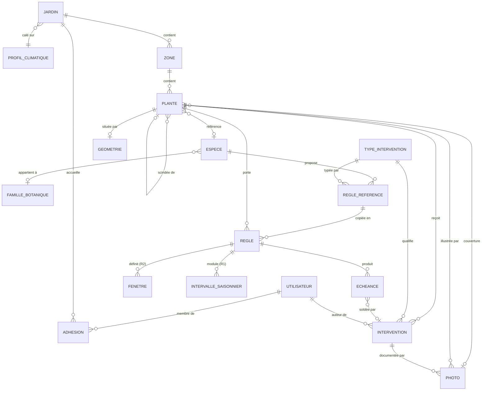
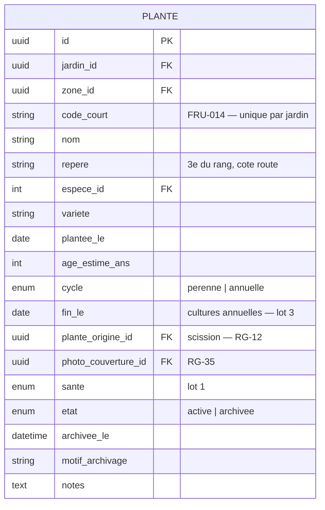
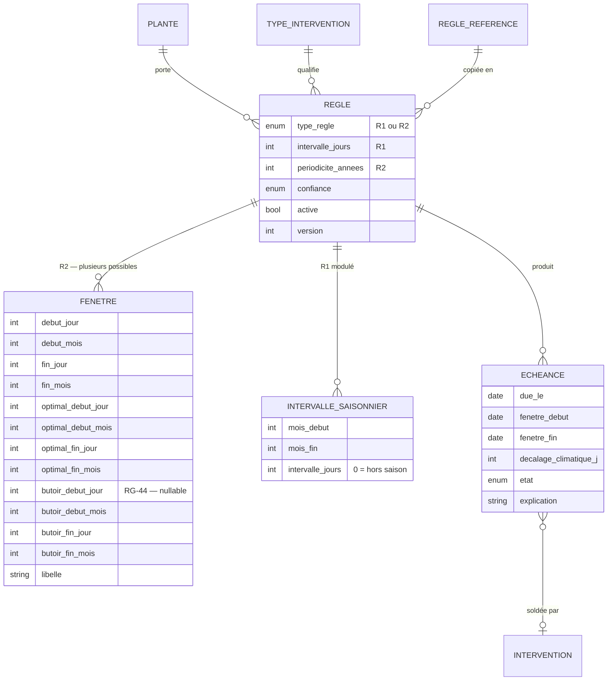

# Modèle de données — Service de gestion de jardin

Version 0.6 — 24/08/2026
Compagnon de `cahier-des-charges-fonctionnel.md` (v0.11). Les références `RG-nn`
et `§n` renvoient à ce document.

Niveau **conceptuel et logique** : entités, attributs, relations, cardinalités.
Aucun choix de moteur de base de données, de nommage physique ou de type SQL
n'est fait ici — c'est l'objet du document technique.

**Colonne « Lot »** : `0` = MVP, `1`…`5` = lot correspondant du §6 du CDC. Elle
dit quand la donnée est *alimentée*, pas quand la colonne est créée : quelques
colonnes existent dès le MVP pour éviter une migration douloureuse plus tard.

---

## 1. Vue d'ensemble

**Dix-sept entités au MVP** (4 + 3 + 4 + 2 + 4, voir le tableau ci-dessous),
dont onze portent un `jardin_id`. Le modèle a été simplifié le 23/08/2026 : plus de
supertype « objet d'entretien », plus de parcelle, plus d'équipement, pas de
contrainte ni d'observation. Trois niveaux, une seule entité qui reçoit des
interventions.



| Bloc | Entités | Nature |
|---|---|---|
| **Socle** | Utilisateur, Jardin, Adhésion, Profil climatique | Compte et cloisonnement. Change rarement. |
| **Terrain** | Zone, Plante, Géométrie | L'inventaire. Change à la saison. |
| **Moteur** | Règle, Fenêtre, Intervalle saisonnier, Échéance | Le cœur. Change quand l'utilisateur corrige une périodicité. |
| **Journal** | Intervention, Photo | Le flux. Croît sans cesse — 10 000 lignes à dix ans. |
| **Référentiel** | Espèce, Famille botanique, Règle de référence, Type d'intervention | Partagé entre jardins, en lecture seule. |

**Reporté, avec le lot qui le ramène :** Produit et règle R3 (lot 2),
Observation et règle R4 (lot 1), Contrainte et règle R5 (lots 3 et 5),
sous-zones et cultures annuelles (lot 3), équipements (hors périmètre).

---

## 2. Socle

### 2.1 UTILISATEUR

| Attribut | Type | Oblig. | Lot | Note |
|---|---|---|---|---|
| `id` | uuid · PK | oui | 0 | |
| `courriel` | texte · unique | oui | 0 | Identifiant de connexion, unique globalement |
| `mot_de_passe_hache` | texte | oui | 0 | Jamais en clair, jamais dans les journaux |
| `nom_affiche` | texte | non | 0 | Signe les interventions quand un jardin est partagé |
| `cree_le` | horodatage | oui | 0 | |
| `derniere_connexion_le` | horodatage | non | 0 | |
| `supprime_le` | horodatage | non | 0 | La suppression RGPD doit être effective, photos comprises |

### 2.2 JARDIN

| Attribut | Type | Oblig. | Lot | Note |
|---|---|---|---|---|
| `id` | uuid · PK | oui | 0 | |
| `proprietaire_id` | uuid · FK | oui | 0 | → Utilisateur |
| `nom` | texte | oui | 0 | « La maison », « Chez mes parents » |
| `profil_climatique_id` | entier · FK | **oui** | 0 | RG-23 — choisi dans une liste de cinq, jamais déduit au MVP |
| `commune_insee` | texte (5) | non | 0 | Proposition du profil climatique (RG-52) ; code seul, jamais une adresse (RG-28) |
| `latitude`, `longitude` | décimal | non | 5 | Donnée personnelle sensible : c'est le domicile (RG-28) |
| `altitude_m` | entier | non | — | Correction fine du décalage, reportée |
| `surface_m2` | entier | non | 0 | Information, et calibrage de la mise en route |
| `quota_photos_mo` | entier | oui | 0 | Protection du disque, sans logique de facturation |

> **RG-22 — le jardin est la racine.** `jardin_id` est porté par **toutes** les
> tables métier, y compris celles qui pourraient le déduire par jointure. La
> redondance est volontaire : elle permet d'imposer le filtrage par défaut au
> lieu de le confier à la discipline de chaque requête.

### 2.3 ADHESION

Association utilisateur × jardin, porteuse du rôle (**RG-20**, §3.1 du CDC).
Le rôle est `proprietaire` ou `membre` — jamais « invité », terme abandonné.

Le MVP crée **un compte propriétaire en base**, sans inscription publique
(RG-41). Les tables du socle existent en entier dès la première migration —
c'est leur présence qui est irrattrapable, pas les écrans qui les alimentent.

| Attribut | Type | Lot | Note |
|---|---|---|---|
| `utilisateur_id` | uuid · FK | 0 | |
| `jardin_id` | uuid · FK | 0 | |
| `role` | énum | 0 | `proprietaire` · `membre` |
| `invite_le`, `accepte_le` | horodatage | 1 bis | Flux d'invitation |

Au MVP, une seule adhésion par jardin. La table existe quand même : l'ajouter
après coup imposerait de reprendre toute l'autorisation.

### 2.4 PROFIL_CLIMATIQUE

Table de référence partagée, non modifiable par l'utilisateur. Cinq lignes.

| id | libellé | décalage | zones USDA |
|---|---|---|---|
| 1 | Midi, littoral méditerranéen | −15 j | 9–10 |
| 2 | Sud-Ouest, vallée du Rhône | −7 j | 8–9 |
| 3 | Plaine tempérée *(référence)* | 0 j | 8 |
| 4 | Nord, Est, océanique frais | +7 j | 7–8 |
| 5 | Montagne, plus de 600 m | +21 j | 5–7 |

> **RG-25** — le décalage s'applique aux **bornes de calendrier** : les fenêtres
> (R2) et les **bornes de saison** d'un intervalle saisonnier (R1). Jamais à la
> **valeur** d'un intervalle — une tonte reste à 7 jours partout, c'est la saison
> qui glisse.
>
> **RG-45** — le décalage appliqué à une fenêtre est **borné par ses butoirs**
> (RG-44, §5.2 ci-dessous). Sans cette borne, un profil à +21 j suffit à faire
> franchir une interdiction de nidification.
>
> **RG-29** — c'est le champ et son application par le moteur qui doivent
> exister au MVP, pas son remplissage automatique.

---

## 3. Terrain

### 3.1 ZONE

Classement pur : elle ne porte **ni intervention, ni règle, ni échéance**
(RG-34). Plate au MVP — pas de sous-zones.

| Attribut | Type | Oblig. | Lot | Note |
|---|---|---|---|---|
| `id` | uuid · PK | oui | 0 | |
| `jardin_id` | uuid · FK | oui | 0 | |
| `nom` | texte | oui | 0 | « Verger haut », « Devant la maison » |
| `zone_parente_id` | uuid · FK | non | 3 | Colonne prévue, non alimentée au MVP — la hiérarchie arrive avec le potager |

### 3.2 PLANTE

La seule entité qui reçoit des interventions. Un individu ou un groupe végétal
traité comme une unité — **la pelouse en fait partie** (RG-16).



| Attribut | Oblig. | Lot | Note |
|---|---|---|---|
| `code_court` | oui, auto | 0 | **RG-13** — `FRU-014`. Unique par jardin, stable à vie, **jamais réattribué** même après archivage : des étiquettes physiques en dépendent |
| `nom` | oui | 0 | Unique au sein de la zone |
| `repere` | non | 0 | La réponse la moins chère au besoin « retrouver » |
| `espece_id` | non | 0 | Une plante « libre » reste possible, avec ses propres règles |
| `variete` | non | 0 | Texte libre : la bibliothèque ne descend pas au niveau variétal |
| `variante` | non | 0 | **RG-51** — variante de conduite choisie à la création (`remontant`), obligatoire si l'espèce en a. Elle dit quelles règles de la bibliothèque ont été proposées ; ce n'est pas la variété |
| `age_estime_ans` | non | 0 | Pour les plantes trouvées sur place, dont on ignore la date |
| `cycle`, `fin_le` | oui / non | 0 / **3** | RG-18 — le champ existe au MVP, le potager non |
| `plante_origine_id` | non | 0 | **RG-12** — scission sans perte d'historique |
| `photo_couverture_id` | non | 0 | **RG-35** — ce qui identifie la plante dans les listes et le sélecteur terrain |
| `sante` | non | 1 | Alimenté par les observations |
| `etat` | oui | 0 | **RG-02** — on archive, on ne supprime jamais |

### 3.3 GEOMETRIE

| Attribut | Type | Note |
|---|---|---|
| `plante_id` | uuid · FK | |
| `forme` | énum | **RG-14** — `point` · `ligne` · `polygone`, les trois dès la première migration |
| `coordonnees` | json | Liste de couples lat/lon |
| `precision_m` | entier | Une position à 12 m ne se corrige pas comme une position pointée sur un plan |
| `source` | énum | `gps` · `manuel` · `plan` |
| `relevee_le` | horodatage | |

> **RG-15 — capturer tôt, exploiter tard.** La position est relevée
> silencieusement à la création d'une plante et aux interventions saisies sur
> le terrain, sans être affichée au MVP. Sans cette capture précoce, le plan du
> terrain imposera de reparcourir tout le jardin, plante par plante.

---

## 4. Référentiel partagé

Aucune de ces tables ne porte de `jardin_id` (sauf `TYPE_INTERVENTION`, voir
plus bas) : elles sont communes à tous les jardins et en lecture seule pour les
utilisateurs. C'est la seule donnée qui traverse la frontière entre jardins.

### 4.1 FAMILLE_BOTANIQUE et ESPECE

| Attribut | Nature | Lot | Note |
|---|---|---|---|
| `famille.nom` | descriptif | 0 | Rosacées, Solanacées… |
| `famille.delai_retour_ans` | **opérationnel** | 3 | Rotation |
| `espece.nom_commun` | descriptif | 0 | |
| `espece.nom_latin` | descriptif | 0 | |
| `espece.categorie` | descriptif | 0 | fruitier · ornement · arbuste · haie · petits fruits · gazon · légume |
| `espece.cycle` | descriptif | 0 | |
| `espece.exposition` | descriptif | 0 | |
| `espece.zone_rusticite` | descriptif | 0 | |
| `espece.hauteur_adulte_cm` | descriptif | 0 | |
| `espece.periode_floraison` | descriptif | 0 | |

> **RG-30** — tout ce qui est **descriptif** n'entre dans aucun calcul : c'est
> la partie de la bibliothèque qu'on peut charger massivement, et elle sert
> immédiatement l'autocomplétion à la saisie, même sans règle attachée.

### 4.2 TYPE_INTERVENTION

| Attribut | Type | Lot | Note |
|---|---|---|---|
| `jardin_id` | uuid · FK | 0 | **Nul** = fourni · renseigné = créé par l'utilisateur (RG-03) |
| `libelle` | texte | 0 | |
| `famille` | énum | 0 | taille · traitement · sol · eau · entretien · cycle · récolte |
| `demande_quantite` | booléen | 1 | Récolte |
| `demande_produit` | booléen | 2 | Traitement |

Seule table du référentiel à porter un `jardin_id` facultatif : RG-03 impose
que le catalogue soit extensible par l'utilisateur.

### 4.3 REGLE_REFERENCE

Les règles types de la bibliothèque, copiées vers une `REGLE` à la création
d'une plante.

| Attribut | Type | Note |
|---|---|---|
| `espece_id` | entier · FK | |
| `variante` | texte | **RG-51** — nul : la règle vaut pour toute l'espèce ; renseigné (`remontant`) : pour cette seule variante de conduite. Les variantes d'une espèce sont celles que portent ses règles |
| `type_intervention_id` | entier · FK | |
| `type_regle` | énum | `R1` · `R2` au MVP |
| `parametres` | json | Donnée d'import, écrite par le curateur |
| `confiance` | énum | **RG-31** — `verifiee` · `indicative`. Jamais de valeur par défaut (S9) |
| `source_url`, `source_libelle` | texte | D'où vient cette périodicité, pour pouvoir la contester. **`source_url` est obligatoire dès que `confiance = verifiee`** — contrainte de base, pas convention (S9, B1 du protocole) |
| `version`, `remplacee_le` | entier, horodatage | **RG-24** |

> **RG-31** — une règle `indicative` est utilisable, mais signalée à
> l'utilisateur quand il l'applique et rappelée dans l'explication de
> l'échéance. C'est ce qui permet de charger largement la bibliothèque sans
> transformer une supposition en certitude.
>
> **RG-24** — corriger une règle type ne modifie **jamais** les règles déjà
> copiées dans un jardin. La correction est proposée — sinon elle déplacerait
> silencieusement les échéances de tous les jardins d'un coup.
>
> **RG-37** — les fenêtres livrées par la bibliothèque **excluent déjà les
> périodes interdites** (nidification). C'est au curateur de le faire une fois,
> pas à l'utilisateur de le refaire à chaque haie.
>
> **RG-44** — et elles portent les **butoirs** correspondants, sans quoi le
> décalage climatique du jardin les fait déborder de la période interdite (§5.2).
> Exclure une période dans la fenêtre et ne pas la border est une demi-mesure qui
> ne se voit qu'en montagne ou dans le Midi.

---

## 5. Le moteur

Trois temps, trois entités (§3.9 du CDC) :

| | Entité | Temps | Exemple |
|---|---|---|---|
| 1 | **Règle** | permanent | « Ce pommier se taille chaque année, entre décembre et mars » |
| 2 | **Échéance** | à venir | « Tailler le pommier du fond, avant le 31 mars 2027 » |
| 3 | **Intervention** | passé | « Taillé le 12 février 2027, 40 min » |



> **RG-39 — définie par la bibliothèque, possédée par l'utilisateur.** La règle
> est écrite par le curateur pour une espèce, **copiée** dans le jardin à la
> création de la plante, et devient dès lors la règle de cette plante.
> `regle.regle_reference_id` garde le lien vers l'origine — pour proposer une
> correction (RG-24), jamais pour l'imposer.
>
> **RG-40 — une règle active produit exactement une échéance à venir.** Jamais
> zéro, jamais plusieurs. Une plante porte plusieurs règles, donc plusieurs
> échéances simultanées.

### 5.1 REGLE

| Attribut | Type | Concerne | Note |
|---|---|---|---|
| `plante_id` | uuid · FK | tous | |
| `type_intervention_id` | entier · FK | tous | |
| `regle_reference_id` | entier · FK | tous | Origine, facultative |
| `type_regle` | énum | tous | `R1` · `R2` au MVP ; R3, R4, R5 aux lots 1, 2, 3 et 5 |
| `intervalle_jours` | entier | R1 | Tonte tous les 7 jours |
| `periodicite_annees` | entier | R2 | 1 = tous les ans, 3 = une année sur trois |
| `confiance` | énum | tous | Héritée de la règle de référence, RG-31 |
| `active` | booléen | tous | Une seule règle **active** par couple (plante, type d'intervention) |
| `version` | entier | tous | RG-08 — ne pas réécrire l'histoire des échéances passées |
| `remplacee_le` | horodatage | tous | Nul tant que la règle est en vigueur |

> **Corriger une règle crée une version, elle n'écrase pas la précédente.**
> L'ancienne passe à `active = faux` et reçoit sa date de remplacement ; la
> nouvelle prend la version suivante. C'est ce qu'exige RG-08 (« historique des
> versions de règle ») et le §9 point 3 du CDC (« modifier une règle ne doit pas
> réécrire l'histoire des échéances passées ») : une échéance matérialisée en
> 2027 doit rester explicable par la règle telle qu'elle était en 2027.
>
> L'unicité porte donc sur (plante, type d'intervention) **parmi les règles
> actives seulement** — jamais sur la table entière, qui conserve les versions
> retirées.

### 5.2 FENETRE (R2)

Une règle peut porter **plusieurs fenêtres** (RG-36) — c'est ce qui couvre un
traitement en deux passages sans avoir besoin de R3.

| Attribut | Type | Note |
|---|---|---|
| `regle_id` | uuid · FK | |
| `debut_jour`, `debut_mois` | entier | Jour et mois, **pas une date** |
| `fin_jour`, `fin_mois` | entier | |
| `optimal_debut_*`, `optimal_fin_*` | entier | La période idéale à l'intérieur de la fenêtre |
| `butoir_debut_jour`, `butoir_debut_mois` | entier, nullable | **RG-44** — borne plancher que le décalage ne franchit jamais |
| `butoir_fin_jour`, `butoir_fin_mois` | entier, nullable | **RG-44** — borne plafond, idem |
| `libelle` | texte | « Chute des feuilles », « Fin d'hiver » |
| `ordre` | entier | |

> **Les butoirs, et pourquoi ils ne sont pas redondants avec la fenêtre.** Une
> fenêtre est écrite dans le climat de référence et **décalée** par le profil du
> jardin (RG-25). Un butoir, lui, ne bouge pas : il est appliqué **après** le
> décalage et **rogne** la fenêtre projetée.
>
> Sans lui, la fenêtre de haie `16/08 → 15/03` — écrite précisément pour exclure
> la nidification (RG-37) — devient `06/09 → 05/04` en montagne et
> `01/08 → 28/02` dans le Midi. L'interdiction est franchie dans les deux sens,
> et rien ne proteste : chacune des deux règles est juste prise isolément.
>
> Un butoir rogne, il ne déplace pas. Si le rognage laisse moins de 14 jours ou
> fait sortir la période optimale — pour **l'un quelconque** des cinq profils —
> c'est une erreur de donnée de la bibliothèque, et la version n'est pas publiée
> (B-T13 du protocole).

> **Piège connu, à couvrir par des tests dès le premier jour.** Une fenêtre à
> cheval sur le changement d'année : `01/12 → 31/03`. Elle n'est pas
> représentée par des dates mais par des couples jour/mois, et toute
> comparaison naïve `debut ≤ aujourd_hui ≤ fin` est fausse dans ce cas. C'est
> la taille des fruitiers à pépins — le cas le plus courant du produit, pas un
> cas limite.

### 5.3 INTERVALLE_SAISONNIER (R1 modulé)

La tonte : 7 j de mars à juin, 14 j en juillet-août, 10 j de septembre à
novembre, 0 en hiver. Une seule règle, quatre lignes — l'utilisateur n'a pas à
créer quatre règles pour une tonte.

| Attribut | Type | Note |
|---|---|---|
| `regle_id` | uuid · FK | |
| `mois_debut`, `mois_fin` | entier | Bornes de **saison**. Le décalage climatique s'y applique (RG-25) : la saison de tonte s'ouvre plus tôt dans le Midi |
| `intervalle_jours` | entier | `0` = hors saison. La **valeur** n'est jamais décalée : 7 jours partout |

> **Hors saison ≠ pas d'échéance.** Un `0` ne supprime pas l'échéance, il la
> **reporte à l'ouverture de la saison suivante** (RG-40). Une règle qui cesse de
> produire une échéance ne redémarrerait jamais : rien ne la réveillerait au
> printemps.

### 5.4 ECHEANCE

| Attribut | Type | Note |
|---|---|---|
| `regle_id`, `plante_id` | uuid · FK | |
| `due_le` | date | |
| `fenetre_debut`, `fenetre_fin` | date | Dates réelles, décalage climatique déjà appliqué |
| `optimal_debut`, `optimal_fin` | date | |
| `decalage_climatique_applique_j` | entier | Permet d'expliquer après coup, même si le profil du jardin a changé depuis |
| `etat` | énum | **En base : `soldee` · `manquee` · `suspendue` uniquement.** `a_venir`, `ouverte`, `optimale` et `urgente` sont des états *calculés* : ils ne sont jamais persistés (décision T3 ci-dessous, S10 du chapitre 4) |
| `intervention_id` | uuid · FK | Celle qui l'a soldée |
| `explication` | texte | **RG-06** — la phrase qui dit d'où vient cette échéance |
| `motif_suspension` | texte | Obligatoire si l'utilisateur écarte l'occurrence |
| `materialisee_le` | horodatage | |

> **Décision T3.** Les échéances futures sont **calculées à la volée** ; une
> échéance n'est **matérialisée** en base qu'au moment où elle reçoit une
> action — faite, reportée, sautée, suspendue — ou où elle bascule en
> `manquee`. Sans cela, RG-07 est impossible à tenir : une échéance manquée
> serait effacée silencieusement, et l'historique perdrait son information la
> plus utile.

> **Décision T4 — l'identité d'une échéance non matérialisée est le couple
> `(regle_id, due_le)`.** La conséquence de T3 est qu'une échéance affichée n'a,
> dans l'immense majorité des cas, aucune ligne en base : elle n'a donc pas
> d'identifiant à porter. Elle doit pourtant être désignable — la vue terrain
> hors ligne l'affiche, la coche et la fait disparaître de sa liste.
>
> Ce couple est **déterministe** : le moteur étant pur (A3), deux calculs à la
> même date rendent la même clé. Un identifiant tiré au hasard à la génération
> changerait à chaque rafraîchissement du paquet terrain, et le client ne
> saurait plus quelle ligne il vient de solder. C'est aussi la clé d'unicité de
> la table (S10).

---

## 6. Journal

### 6.1 INTERVENTION

| Attribut | Type | Lot | Note |
|---|---|---|---|
| `plante_id` | uuid · FK | 0 | Une seule plante par ligne |
| `type_intervention_id` | entier · FK | 0 | |
| `auteur_id` | uuid · FK | 0 | Présent dès le MVP, même avec un seul compte |
| `faite_le` | date | 0 | Date locale, **sans heure** |
| `duree_min` | entier | 0 | |
| `note` | texte long | 0 | |
| `lot_saisie_id` | uuid | 0 | Regroupe une saisie portant sur plusieurs plantes |
| `position_capturee` | json | 0 | RG-15 |
| `saisie_le` | horodatage | 0 | |
| `synchronisee_le` | horodatage | 0 | Trace de la remontée hors ligne |
| `quantite`, `unite` | décimal, énum | 1 | Récolte — kg · nombre · cageot · litre |
| `produit_id`, `dose_appliquee` | FK, texte | 2 | |

| Point | Règle |
|---|---|
| Une intervention par plante | **RG-04** — une saisie multi-plantes se décompose ; `lot_saisie_id` garde le lien pour corriger ou annuler le lot entier |
| `faite_le` ≠ `saisie_le` | **RG-05** — la date rétroactive est le cas nominal : on saisit le lundi ce qu'on a fait le samedi |
| Date sans heure | L'heure n'a aucun sens ici et introduit des décalages d'un jour |
| `synchronisee_le` | **RG-01** — base de la résolution de conflit après une saisie hors ligne |

### 6.2 PHOTO

| Attribut | Type | Note |
|---|---|---|
| `plante_id` | uuid · FK | Facultatif |
| `intervention_id` | uuid · FK | Facultatif |
| `chemin_original` | texte | Sur disque — pas de service de stockage externe (nom de colonne du chapitre 4) |
| `taille_ko` | entier | Compte dans le quota du jardin |
| `largeur_px`, `hauteur_px` | entier | |
| `prise_le`, `televersee_le` | date, horodatage | |

Deux usages distincts, même table :

- **Photo de couverture** d'une plante (RG-35) — `plante.photo_couverture_id`
  pointe vers l'une de ses photos. Elle identifie la plante dans les listes.
- **Photo d'intervention** (RG-38) — elle montre que c'est fait et dans quel
  état. Jamais obligatoire : l'imposer casserait le parcours à trois gestes.

Poste de stockage dominant du service : compression à l'envoi, quota par
jardin, et **purge réelle du fichier** à la suppression du compte.

---

## 7. Décisions techniques — recommandations

Les décisions sont classées par **coût d'une erreur**, pas par ordre
d'apparition. Les trois premières sont difficiles ou impossibles à rattraper ;
les autres se corrigent.

### D1 — Cloisonnement entre jardins · *irrattrapable*

**Question.** Comment garantir qu'aucune requête ne rende une donnée d'un autre
jardin ?

**Recommandation : le filtrage est imposé par l'infrastructure, jamais écrit à
la main.** Concrètement, l'une de ces trois voies selon la stack :
une portée globale appliquée par défaut à tout modèle, un décorateur de
connexion qui positionne le jardin courant, ou une politique de sécurité au
niveau de la base. Le point commun : **oublier le filtre doit être
impossible**, pas seulement déconseillé.

**Pourquoi c'est la première.** Une fuite entre jardins n'est pas un bug qu'on
corrige : c'est un incident qu'on déclare. Et elle se produit par omission dans
*une* requête sur trois cents, pas par erreur de conception.

**Test d'acceptation :** critère 12 du §10 — créer un second compte, tenter
d'atteindre les données du premier par URL devinée.

### D2 — Identifiants · *coûteux à changer*

**Question.** UUID ou entiers auto-incrémentés ?

**Recommandation : UUID**, générés côté client pour tout ce qui se crée sur le
terrain.

**Pourquoi.** Le hors-ligne l'impose (RG-01) : une plante créée sans réseau
doit avoir son identifiant immédiatement, et ses photos et interventions
doivent pouvoir le référencer avant toute synchronisation. Avec des entiers
séquentiels, il faudrait des identifiants temporaires puis une réécriture à la
remontée — mécanisme classique, mais qui casse dès qu'une référence traîne
quelque part.

**Nuance.** Les tables de référence (espèce, type d'intervention, profil
climatique) peuvent garder des entiers : elles ne se créent jamais hors ligne.

### D3 — Matérialisation des échéances · *structure le moteur*

**Question.** Les échéances sont-elles stockées ou recalculées ?

**Recommandation : calcul à la volée, matérialisation à la première action.**
Une échéance devient une ligne en base quand elle est faite, reportée, sautée,
suspendue, ou quand elle bascule en `manquee`.

**Pourquoi.** Tout stocker oblige à régénérer des milliers de lignes à chaque
modification de règle, et à gérer leur péremption. Ne rien stocker rend RG-07
intenable : une échéance manquée disparaîtrait, alors que c'est l'information
qui explique l'état du végétal l'année suivante.

**Conséquence à assumer :** le moteur doit être **déterministe** — mêmes
règles, même historique, même date ⇒ mêmes échéances. C'est ce qui rend le
calcul à la volée fiable, et c'est testable.

### D4 — Paramètres des règles · *confort de développement*

**Question.** Colonnes dédiées ou champ JSON ?

**Recommandation : colonnes sur `REGLE`, JSON sur `REGLE_REFERENCE`.**

**Pourquoi.** `REGLE` est lue à chaque calcul et éditée par l'utilisateur : les
colonnes donnent des contraintes vérifiées par la base et des requêtes
possibles. `REGLE_REFERENCE` est une donnée d'import écrite par le curateur,
dont le format évoluera avec la bibliothèque : le JSON y absorbe les
changements sans migration.

**Simplification apportée par le MVP :** avec R1 et R2 seulement, `REGLE` ne
porte que deux paramètres propres. La question perd beaucoup de son poids.

### D5 — Stockage de la géométrie · *facilement réversible*

**Question.** JSON ou type géographique natif ?

**Recommandation : JSON au MVP.** La seule fonction géométrique du MVP est le
tri par proximité, qui se calcule très bien en mémoire sur 500 plantes.

**Quand rouvrir :** au lot 4, quand la carte demandera des recherches
spatiales. Le passage à un type natif est alors une migration simple, sur des
données déjà propres — d'où l'importance de stocker `precision_m` et `source`
dès maintenant.

**Rouvert le 19/10/2026, avec l'entrée du lot 4 en V1 (CDC §6) : le JSON est
maintenu.** Les fonctions de la carte (affichage, glisser-déposer, « qu'y a-t-il
à faire ici ? », ordre de tournée) portent sur le jardin courant, donc sur
500 plantes au plus. Elles se calculent en mémoire, côté serveur ou côté
téléphone, sans requête spatiale. Le format est du **GeoJSON** (géométrie
`Point`, `LineString` ou `Polygon`, coordonnées en WGS 84), ce que lisent
directement les bibliothèques de carte.

*Écarté :* l'extension PostGIS. Elle serait justifiée par des recherches
spatiales en base sur de gros volumes, et le CDC n'en demande aucune (§6 lot 4,
« hors V1 »). Elle ajouterait une extension à installer, sauvegarder et
restaurer, contre l'esprit de §8.6. La migration reste simple le jour où un
besoin réel apparaît.

### D6 — Suppression RGPD · *obligation légale*

**Question.** Effacement réel ou anonymisation ?

**Recommandation : effacement réel**, fichiers photo compris.

**Pourquoi.** L'anonymisation se justifie quand des données agrégées ont de la
valeur. Ici, l'historique d'un jardin supprimé n'a aucune valeur pour personne.
L'effacement est plus simple à implémenter, plus simple à prouver, et ne laisse
pas de dette.

**Piège :** la purge des fichiers doit être vérifiée, pas supposée. Un
enregistrement supprimé dont la photo reste sur le disque n'est pas une
suppression.

### D7 — Garder le moteur agnostique de sa cible · *coût nul aujourd'hui*

**Question.** Le moteur d'échéances doit-il connaître le mot « plante » ?

**Recommandation : non.** Le moteur prend **une cible et ses règles**, et rend
des échéances. Que la cible soit une plante est une information de
l'appelant, pas du moteur.

**Pourquoi.** Le MVP décide que seule la plante reçoit des interventions
(RG-34), et c'est le bon choix pour aujourd'hui. Mais le lot 3 ramènera la
question : amender une planche, décompacter, bâcher — ces gestes portent sur le
sol, pas sur un végétal, et aucun contournement honnête n'existe.

Si l'abstraction vit **dans le code du moteur** sans être matérialisée en base,
l'extension coûte une colonne nullable et une bascule. Si le moteur est écrit
autour de `plante_id`, elle coûte une réécriture du composant le plus testé et
le plus délicat du produit.

C'est le seul endroit du modèle où prévoir l'avenir ne coûte rien : une
signature de fonction, pas une table.

**Et la migration du lot 3 ne ramènera pas le supertype.** Deux clés étrangères
nullables et exclusives suffisent :

```
intervention.plante_id  ┐  l'une OU l'autre, jamais les deux
intervention.zone_id    ┘  (contrainte CHECK)

regle.plante_id  ┐  idem
regle.zone_id    ┘
```

Un supertype ne se justifie que quand **plusieurs natures partagent beaucoup de
champs**. Il n'en restera que deux, et elles n'ont presque rien en commun : une
zone n'a ni espèce, ni âge, ni santé, ni production, ni photo de couverture.
Réintroduire `OBJET` coûterait une jointure dans chaque requête et une
abstraction dans chaque écran, pendant deux ans, pour un besoin qui n'existe
pas encore.

### D9 — Le décalage climatique est borné · *sinon il franchit des interdits*

**Question.** Faut-il laisser le décalage climatique s'appliquer sans limite aux
fenêtres ?

**Recommandation : non — chaque fenêtre peut porter des butoirs** (RG-44), en
jour/mois, appliqués après la projection et après le décalage.

**Pourquoi.** Le décalage est une approximation assumée (§5.4 du CDC) ; une
interdiction de nidification n'en est pas une. Deux règles justes prises
séparément — « la fenêtre exclut la période interdite » (RG-37) et « le moteur
décale la fenêtre » (RG-25) — produisent ensemble une taille de haie proposée le
15 avril en montagne. Le butoir est la seule borne qui ne dépende pas du profil.

Il sert aussi le cas plus doux : on ne plante pas en décembre, même à Perpignan.
Un décalage de 15 jours n'a pas à rendre une fenêtre agronomiquement absurde.

**Piège :** un butoir qui rogne trop est pire que pas de butoir — il produit une
fenêtre de trois jours que personne ne verra passer. D'où le test B-T13, qui
vérifie le rognage **pour les cinq profils**, pas seulement pour la référence.

### D10 — Une règle corrigée est versionnée, jamais écrasée · *irrattrapable*

**Question.** Que devient l'ancienne règle quand l'utilisateur en corrige une ?

**Recommandation : elle est désactivée et conservée**, la nouvelle prend la
version suivante. L'unicité (plante, type d'intervention) ne porte que sur les
règles **actives**.

**Pourquoi.** RG-08 promet un « historique des versions de règle » et le §9
point 3 du CDC interdit de « réécrire l'histoire des échéances passées ». Une
échéance matérialisée en 2027 porte son explication (RG-06) : si la règle qui
l'a produite a été écrasée, cette explication devient invérifiable. Et comme les
échéances passées sont précisément ce qui donne de la valeur à l'outil au bout
de trois saisons (RG-11), les perdre coûte cher et tard.

### D11 — Ce qui n'a plus besoin d'être tranché

*(Numérotée D8 jusqu'au 24/08/2026 ; renumérotée pour rester après D9 et D10.)*

| Ancienne décision | Devenue sans objet parce que |
|---|---|
| Héritage du supertype `OBJET` | Il n'y a plus de supertype : la plante est la seule entité d'entretien (RG-34) |
| Parcours de la hiérarchie de zones | Les zones sont plates au MVP (§3.3) |
| Modélisation des équipements | Hors périmètre (§3.5) |
